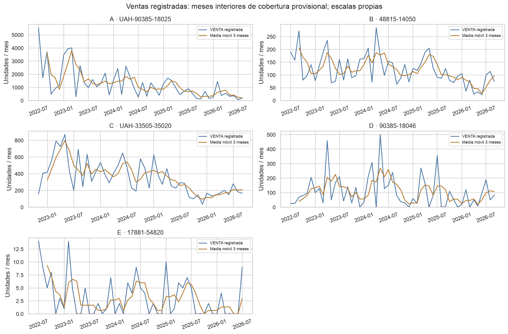
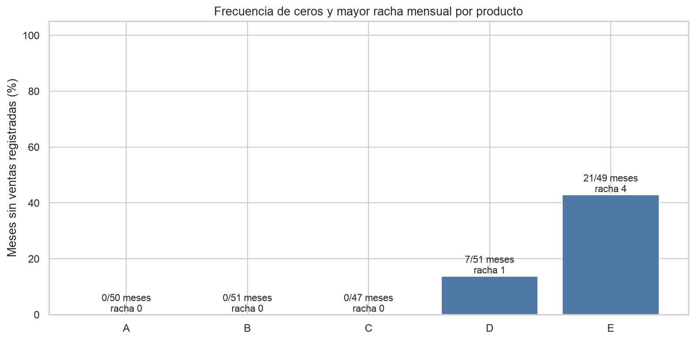
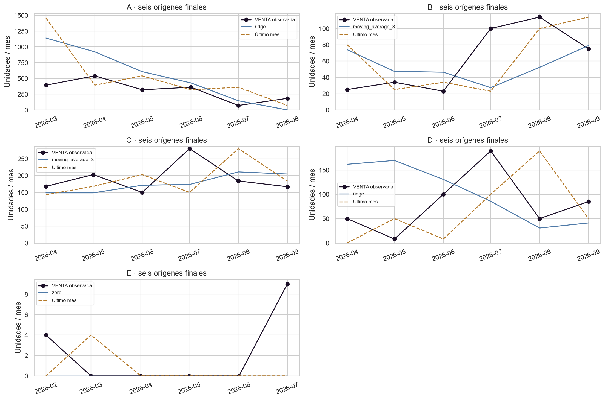
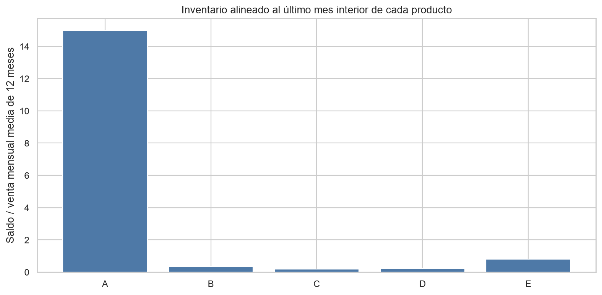
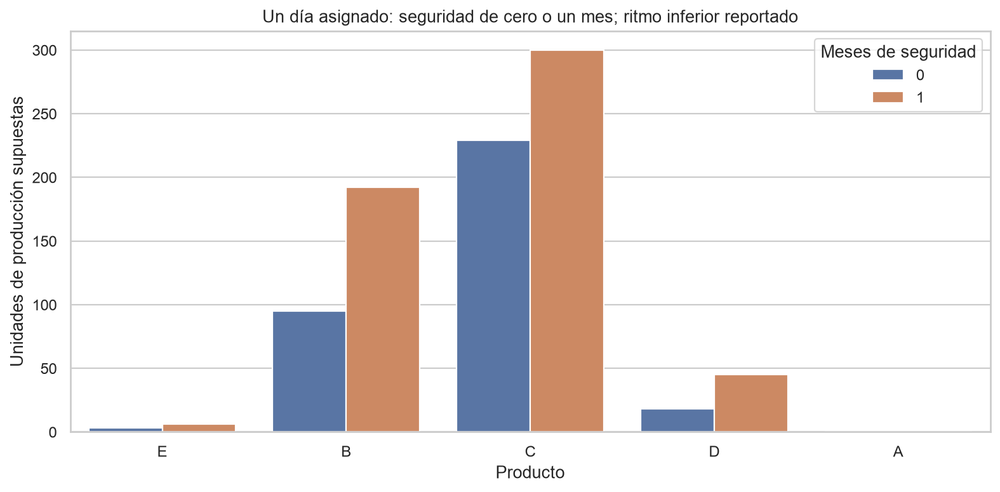

# RUJAF: ampliación del sistema a 5 productos

Experimento `five_products_v1`, fecha de análisis 2026-10-26. Los resultados anteriores de dos productos siguen en `reports/tables/`, `data/processed/` y `artifacts/`. Esta ejecución escribe en subdirectorios de experimentos y comprueba sus huellas antes y después. Los ejemplos A y B mantienen sus particiones originales. Reentrenar sobre esos mismos meses no aporta una prueba independiente nueva.

## Integridad y procedencia

Se procesan 2,108 movimientos una sola vez desde el consolidado autoritativo. Los individuales, el consolidado de tres productos y el anterior son controles de multiconjuntos, no fuentes que se suman. Las 258 combinaciones producto/mes concilian con el CSV mensual preliminar; también se recalculan las afirmaciones de `verificacion_kardex.json`.

| product_id   | codigo_producto   |   movements | empresa_para_el_analisis   | empresa_documento   | pdf_origen            |
|:-------------|:------------------|------------:|:---------------------------|:--------------------|:----------------------|
| A            | UAH-90385-18025   |         583 | RUJAF                      | RUJAF               | 90385-18025.pdf       |
| B            | 48815-14050       |         479 | RUJAF                      | RUJAF               | 48815-14050.pdf       |
| C            | UAH-33505-35020   |         815 | RUJAF                      | REFAMA              | doc_261026_152501.pdf |
| D            | 90385-18046       |         157 | RUJAF                      | RUJAF               | doc_261026_151900.pdf |
| E            | 17881-54820       |          74 | RUJAF                      | RUJAF               | doc_261026_152754.pdf |

El encabezado REFAMA de C se conserva como procedencia. Los cinco documentos forman el conjunto de RUJAF por instrucción de la empresa; esa asignación no prueba propiedad ni consumo final. Los destinatarios Refama identifican movimientos registrados, no venta al consumidor. Se conservan ventas en cero, traslados, ajustes, devoluciones, compras e ingresos por producción. Solo `VENTA.salida` alimenta el objetivo bruto.

| codigo_producto   |   negative_balance |   zero_balance |   zero_quantity_sale |   balance_discrepancy |   source_date_reversal |   source_order_reversal |   repeated_business_candidate |
|:------------------|-------------------:|---------------:|---------------------:|----------------------:|-----------------------:|------------------------:|------------------------------:|
| 17881-54820       |                  0 |              3 |                    0 |                     0 |                      0 |                       0 |                             0 |
| 48815-14050       |                  0 |              5 |                    0 |                     0 |                      0 |                       0 |                             8 |
| 90385-18046       |                  0 |              5 |                    1 |                     0 |                      0 |                       0 |                             0 |
| UAH-33505-35020   |                  1 |             12 |                    0 |                     0 |                      0 |                       0 |                             4 |
| UAH-90385-18025   |                  2 |              5 |                    0 |                     0 |                      0 |                       0 |                             4 |

El primer saldo no tiene antecesor independiente. Los demás saldos se verifican aritméticamente; esto no certifica existencias físicas. Ceros de inventario y períodos sin ventas requieren revisión, no equivalen a faltantes reales medidos.

## Historial y diferencias de demanda

| codigo_producto   |   all_observed_sales_units |   all_sales_transactions |   complete_months |   monthly_mean |   monthly_cv |   zero_periods |   longest_zero_run_months | demand_class   |
|:------------------|---------------------------:|-------------------------:|------------------:|---------------:|-------------:|---------------:|--------------------------:|:---------------|
| 17881-54820       |                    166.000 |                       64 |                49 |          3.163 |        1.211 |             21 |                         4 | intermittent   |
| 48815-14050       |                   6437.000 |                      434 |                51 |        121.333 |        0.484 |              0 |                         0 | smooth         |
| 90385-18046       |                   5578.000 |                      132 |                51 |        107.235 |        1.066 |              7 |                         1 | erratic        |
| UAH-33505-35020   |                  16802.000 |                      702 |                47 |        353.979 |        0.574 |              0 |                         0 | smooth         |
| UAH-90385-18025   |                  66423.000 |                      513 |                50 |       1278.760 |        0.928 |              0 |                         0 | erratic        |

Los totales observados incluyen fronteras; las medias y los modelos excluyen el primer y último mes de cada Kardex por cobertura no confirmada. Los meses interiores sin ventas se conservan en el calendario como cero registrado, no como demanda real cero. La clasificación ADI/CV² depende de la agregación mensual. `daily_intermittency.csv` conserva el diagnóstico diario.

Tendencias, YTD comparable, perfiles de calendario, ACF, STL y cambios exploratorios se recalculan por producto y canal en las tablas. Las pruebas armónicas y sus ajustes FDR ahora abarcan hasta 15 series, en vez de seis. Los valores q nuevos no sustituyen los históricos ni prueban una temporada operativa estable. Las series cortas no reciben diagnósticos anuales ni selección de modelos sin historia suficiente.

## Montos y producción reportados

| product_id   |   monto_reportado_gtq | clasificacion_monto              |   produccion_aproximada_diaria_min |   produccion_aproximada_diaria_max |
|:-------------|----------------------:|:---------------------------------|-----------------------------------:|-----------------------------------:|
| A            |                 2.500 | precio_venta_neto_tras_descuento |                                800 |                                800 |
| B            |                12.000 | precio_venta_neto_tras_descuento |                                210 |                                210 |
| C            |                15.000 | precio_venta_neto_tras_descuento |                                300 |                                300 |
| D            |                 2.500 | precio_venta_neto_tras_descuento |                                480 |                                480 |
| E            |               100.000 | precio_venta_neto_tras_descuento |                                 30 |                                 35 |

A, B, C, D y E tienen precios de venta netos tras descuentos confirmados (Q2.50, Q12.00, Q15.00, Q2.50 y Q100.00; clasificación `precio_venta_neto_tras_descuento`). Ninguno se convierte en costo de fabricación verificado, margen o ahorro. Multiplicar unidades vendidas o pronosticadas por el precio neto correspondiente produce únicamente un escenario de ingresos estimados: como se desconocen las variaciones de precios durante todo el período, no equivale a ingresos históricos reales. Los ritmos son aproximaciones por día productivo, no producción constante ni máximos certificados. En E se conserva y prueba el rango de 30 a 35, sin reemplazarlo por un promedio implícito.

## Comparación de modelos ejecutada

Se comparan los 13 métodos originales y una referencia cero. Croston-SBA y TSB de StatsForecast se incorporan cuando los primeros 24 meses contienen al menos dos meses positivos y 20% de ceros. La elegibilidad queda fijada antes de validación; no se usa el perfil de toda la serie ni el holdout para elegir candidatos. SBA usa suavizado fijo 0.1; TSB usa alpha de tamaño y ocurrencia 0.2, sin búsqueda posterior de parámetros.

Se conservan 24 meses iniciales, validación creciente de un paso y seis meses finales reservados. Se selecciona el más simple dentro del 5% del menor MAE de validación. Cada producto y canal puede elegir otro método. RMSE, WAPE, sesgo y MASE acompañan al MAE; WAPE y MASE indefinidos se publican como ausentes, no cero. Un método con fallos no compite como si hubiese completado todos los orígenes. Los errores de ajuste se conservan en `backtest_predictions.csv`.

| codigo_producto   | model            |   selected_validation_mae |   n_validation | holdout_start       | holdout_end         |     mae |   wape |    bias |   positive_actual_months |   naive_holdout_mae |
|:------------------|:-----------------|--------------------------:|---------------:|:--------------------|:--------------------|--------:|-------:|--------:|-------------------------:|--------------------:|
| 17881-54820       | zero             |                     2.474 |             19 | 2026-02-01 00:00:00 | 2026-07-01 00:00:00 |   2.167 |  1.000 |  -2.167 |                        2 |               2.833 |
| 48815-14050       | moving_average_3 |                    34.952 |             21 | 2026-04-01 00:00:00 | 2026-09-01 00:00:00 |  37.333 |  0.604 |  -7.444 |                        6 |              34.167 |
| 90385-18046       | ridge            |                    79.519 |             21 | 2026-04-01 00:00:00 | 2026-09-01 00:00:00 |  78.388 |  0.976 |  22.806 |                        6 |              74.500 |
| UAH-33505-35020   | moving_average_3 |                    89.824 |             17 | 2026-04-01 00:00:00 | 2026-09-01 00:00:00 |  44.333 |  0.231 | -15.667 |                        6 |              59.333 |
| UAH-90385-18025   | ridge            |                   380.649 |             20 | 2026-03-01 00:00:00 | 2026-08-01 00:00:00 | 290.187 |  0.932 | 228.853 |                        6 |             312.333 |

MAE en unidades mensuales. Las ventanas finales difieren entre productos, por lo que no se interpreta su MAE absoluto como una clasificación de dificultad compartida. En series intermitentes, un buen MAE o una selección de cero no establece demanda inexistente ni una política de servicio adecuada. La cantidad de meses positivos del holdout indica cuánta evidencia respalda la comparación.

`historical_model_comparison.csv` muestra las diferencias de cada candidato original frente a los resultados archivados. No se escoge retrospectivamente al ganador del holdout. Los artefactos seleccionados se guardan en el directorio de este experimento. No cargar archivos pickle de fuentes no confiables.

## Inventario, escenarios y simulación

Se calcularon 48 escenarios puntuales con saldo alineado al origen, días asignados, seguridad, ritmo reportado y factores de venta previstos configurables. El escenario base mantiene 30 días por mes, revisión de 30 días, plazo total de 7 días, días asignados de 1 o 5 y seguridad de cero o un mes. El factor 1.5 es estrés de la previsión, no una observación. El rango de ritmo de E tiene dos extremos. Las asignaciones son por SKU y no constituyen un calendario conjunto de fábrica.

| status                           |   alternativas |
|:---------------------------------|---------------:|
| hypothetical_production_scenario |             48 |

Los estados bloqueados no son cantidades de producción cero. Faltan entradas antes de poder calcularlos.

Los controles de validez conservan el respaldo MA3 y el bloqueo de resultados inválidos. En este experimento se permite una previsión positiva después de tres meses en cero, para no invalidar por definición las tasas intermitentes. Los controles siguen siendo provisionales y su replay es diagnóstico posterior, no evidencia independiente de precisión ni garantía de servicio. Las ventas del mes frontera solo se muestran como contraste posterior, nunca como entrada de entrenamiento o de decisión.

`production_replay.csv` y `production_replay_daily.csv` simulan decisiones mensuales y recepciones con plazo explícito durante los seis orígenes finales. El saldo simulado se arrastra entre días y meses. Las decisiones ven solo el pronóstico y stock disponibles al origen; las ventas diarias registradas posteriores sirven como retiros de evaluación. No se agregan como suministro los ingresos reales, ajustes o traslados históricos, pues el replay estudia otra política. La demanda no atendida es venta registrada no servida por la política simulada, no pérdida real estimada ni demanda final. Se asume recepción antes de los retiros del día y ausencia de atrasos trasladados; no se mide ahorro ni factibilidad real.

Todos los pronósticos siguientes son retrospectivos de frontera, con fechas propias de cada producto. No hay pronóstico operativo vigente ni orden de fabricación autorizada. Faltan stock físico actual, cobertura reciente confirmada, restricciones compartidas, materiales, rendimientos y costos completos. No se afirma optimalidad económica.

## Evidencia de ejecución

Las tablas y figuras de esta carpeta se generaron con el programa, no con cifras ilustrativas. `artifacts/experiments/five_products_v1/run_metadata.json` registra configuración, versiones y hashes de código; `source_manifest.json` registra las entradas. Las pruebas de regresión históricas siguen separadas de `tests/test_expansion.py`.
