# RUJAF manufacturing, finished-goods inventory and wholesale forecasting

Reproducible historical analysis as of **2026-10-26**, with a business-context update.
Historical quantities and errors remain in units; the explicitly unclassified reference amounts in section 13 are GTQ.

## Scope and evidence

**RUJAF manufactures and wholesales automotive components; Refama operates retail stores.** The Kardex
belongs to RUJAF. Sales to Refama are RUJAF shipments supplying the retail business, not consumer sell-through.
The three streams remain `refama` (shipments to Refama), `other` (sales to other customers), and `combined`
(total recorded RUJAF outgoing VENTA). Combined actuals equal the two disjoint streams, counted once.

The combined target remains a useful provisional RUJAF finished-goods planning target because both channels
draw from its stock. It measures recorded wholesale fulfillment, not unconstrained orders, all inventory outflows,
or retail consumption. Maintain channel diagnostics; independent forecasts do not automatically reconcile.
Future Refama POS sales should inform retail replenishment via branch stock/transfer reconciliation, **not be
added to RUJAF shipments** for the same units. Returns and non-sale movements stay separate.

Non-fiscal dispatch documents are reported. Their legal/accounting treatment is unverified; reconcile their
physical movements to the Kardex using unique documents without duplication. This analysis neither endorses
their tax treatment nor includes tax avoidance as an optimization objective.
No actual savings, verified lost sales, confirmed manufacturing capacity/lead times, or optimal policy is estimated.
Original report prose is preserved in `history/pre_rujaf_update/`; original numerical tables, models, figures,
executed notebook, raw datasets and tests remain intact. Section 13 adds a separately labeled provisional layer.

There are 1,062 preserved movements, independently reconciled to the two product CSVs.
All reconstructed product-month totals match the preliminary reference, which is not used as the modeling source.
Boundary months are excluded; interior months remain provisionally complete, not independently verified.
See [data quality](data_quality.md) for all flags and their forecasting consequences.

## 1–2. Historical sales and direction

| codigo_producto   |   all_observed_sales_units |   all_sales_transactions |   complete_months |   monthly_mean |   monthly_median |   monthly_std |   monthly_min |   monthly_max |
|:------------------|---------------------------:|-------------------------:|------------------:|---------------:|-----------------:|--------------:|--------------:|--------------:|
| 48815-14050       |                       6437 |                      434 |                51 |        121.333 |          105.000 |        58.702 |            23 |           285 |
| UAH-90385-18025   |                      66423 |                      513 |                50 |       1278.760 |          949.500 |      1186.111 |            71 |          5530 |

Totals include unconfirmed boundaries; monthly moments and models use only interior months.

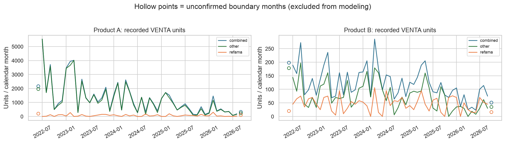
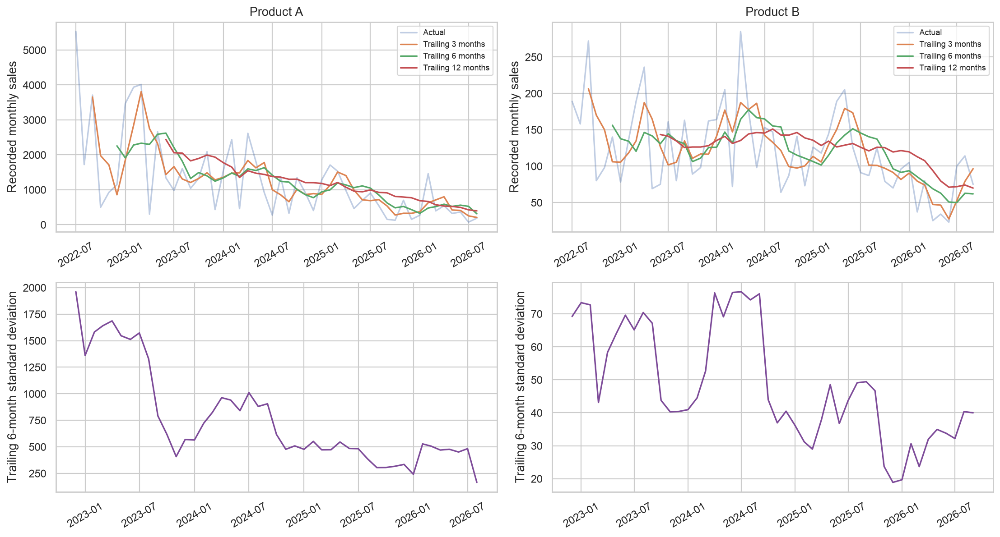

Trend model: OLS of `log1p(monthly recorded sales)` on time with HAC(3) standard errors.
False-discovery-rate q-values use Benjamini–Hochberg across all six product/scenario tests.
These are exploratory conditional associations, not identified causes or guaranteed future growth rates.

| codigo_producto   |   estimated_monthly_change |   slope_ci_low |   slope_ci_high |   hac_slope_q_bh |   kendall_tau |   first_12_mean |   last_12_mean |   last_12_vs_first_12 |
|:------------------|---------------------------:|---------------:|----------------:|-----------------:|--------------:|----------------:|---------------:|----------------------:|
| 48815-14050       |                     -0.017 |         -0.028 |          -0.006 |            0.005 |        -0.290 |         143.417 |         69.833 |                -0.513 |
| UAH-90385-18025   |                     -0.043 |         -0.059 |          -0.030 |            0.000 |        -0.469 |        2437.250 |        393.250 |                -0.839 |

`estimated_monthly_change` is a fraction on the log1p-sales scale; confidence limits are log slopes.
Comparable YTD totals use the same January-to-latest-interior-month window in every included year:

| codigo_producto   | scenario   |   year |   through_month |   sales_units | yoy_growth           |
|:------------------|:-----------|-------:|----------------:|--------------:|:---------------------|
| 48815-14050       | combined   |   2023 |               9 |          1188 | —                    |
| 48815-14050       | combined   |   2024 |               9 |          1364 | 0.14814814814814814  |
| 48815-14050       | combined   |   2025 |               9 |          1211 | -0.1121700879765396  |
| 48815-14050       | combined   |   2026 |               9 |           593 | -0.5103220478943022  |
| UAH-90385-18025   | combined   |   2023 |               8 |         18304 | —                    |
| UAH-90385-18025   | combined   |   2024 |               8 |         11424 | -0.37587412587412583 |
| UAH-90385-18025   | combined   |   2025 |               8 |          8100 | -0.2909663865546218  |
| UAH-90385-18025   | combined   |   2026 |               8 |          3596 | -0.5560493827160493  |

**Product A — UAH-90385-18025:** the fitted trajectory is decreasing (supported by this exploratory trend test; q=4.628e-09). The last 12-month average is -83.9% versus the first 12. Refama accounts for 5.6% of all recorded VENTA units. Monthly CV=0.93, ADI=1.00, CV² on positive months=0.86: the conventional monthly demand-shape label is **erratic**.

**Product B — 48815-14050:** the fitted trajectory is decreasing (supported by this exploratory trend test; q=0.005033). The last 12-month average is -51.3% versus the first 12. Refama accounts for 37.2% of all recorded VENTA units. Monthly CV=0.48, ADI=1.00, CV² on positive months=0.23: the conventional monthly demand-shape label is **smooth**.

Sales contributions and concentration (customer identity never published):

| codigo_producto   | scenario   |   all_observed_sales_units |   monthly_mean |   monthly_cv |   zero_periods |   top_5_orders_share |   top_10pct_orders_share |   top_customer_share |
|:------------------|:-----------|---------------------------:|---------------:|-------------:|---------------:|---------------------:|-------------------------:|---------------------:|
| 48815-14050       | combined   |                       6437 |        121.333 |        0.484 |              0 |                0.047 |                    0.251 |                0.161 |
| 48815-14050       | other      |                       4042 |         75.078 |        0.669 |              2 |                0.074 |                    0.290 |                0.085 |
| 48815-14050       | refama     |                       2395 |         46.255 |        0.592 |              4 |                0.092 |                    0.186 |                0.432 |
| UAH-90385-18025   | combined   |                      66423 |       1278.760 |        0.928 |              0 |                0.090 |                    0.517 |                0.050 |
| UAH-90385-18025   | other      |                      62700 |       1210.300 |        0.970 |              0 |                0.096 |                    0.500 |                0.053 |
| UAH-90385-18025   | refama     |                       3723 |         68.460 |        1.041 |             12 |                0.215 |                    0.295 |                0.541 |

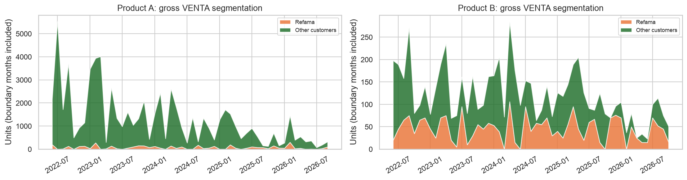
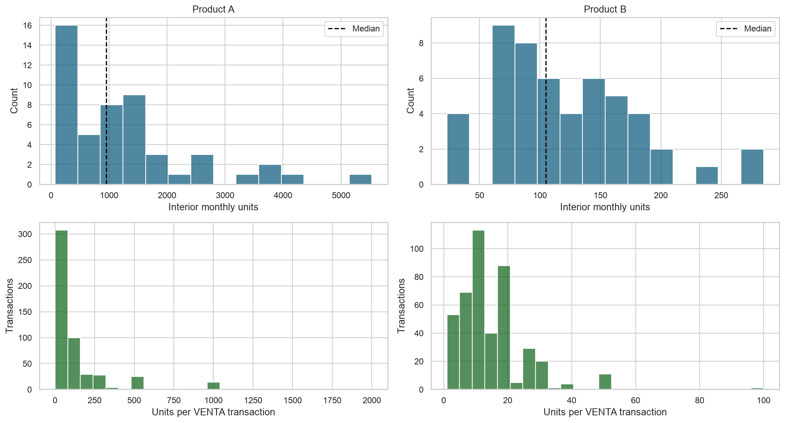
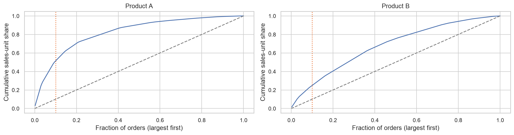

## 3. Is seasonality statistically credible?

| codigo_producto   |   annual_harmonic_hac_p |   harmonic_q_bh |   acf_lag_12 |   acf12_ci_low |   acf12_ci_high |   stl_seasonal_strength_descriptive |   years_per_calendar_month_min |   years_per_calendar_month_max |
|:------------------|------------------------:|----------------:|-------------:|---------------:|----------------:|------------------------------------:|-------------------------------:|-------------------------------:|
| 48815-14050       |                   0.926 |           0.926 |       -0.096 |         -0.406 |           0.215 |                               0.173 |                              4 |                              5 |
| UAH-90385-18025   |                   0.005 |           0.014 |        0.052 |         -0.249 |           0.353 |                               0.129 |                              4 |                              5 |

The annual harmonic test includes a trend and uses HAC(3), then FDR adjustment across six series.
ACF is computed after linear detrending of log1p sales; its intervals are approximate and not a
multiple-lag test. STL uses period 12 and robust fitting; its in-sample seasonal strength is descriptive,
**not** a significance test. Only roughly four annual cycles are available. A single peak year or large
STL component cannot establish a stable business season. Inspect cross-year consistency and seasonal-naive
out-of-sample results before operational use.

- **Product A:** There is exploratory annual-harmonic evidence (q=0.0144); lag-12 ACF=0.052 (inside its approximate zero-including confidence range). Stable operational seasonality is not established by this short sample alone.

- **Product B:** There is no FDR-significant annual-harmonic evidence (q=0.9256); lag-12 ACF=-0.096 (inside its approximate zero-including confidence range). Stable operational seasonality is not established by this short sample alone.

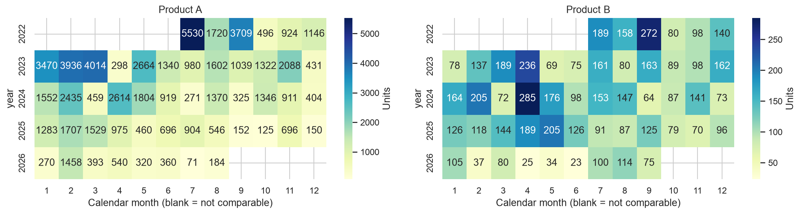
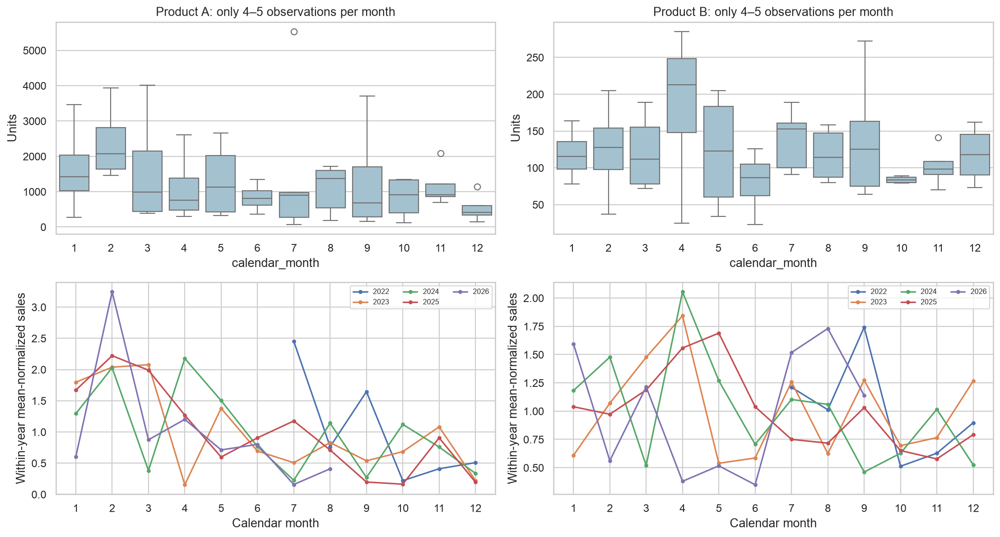
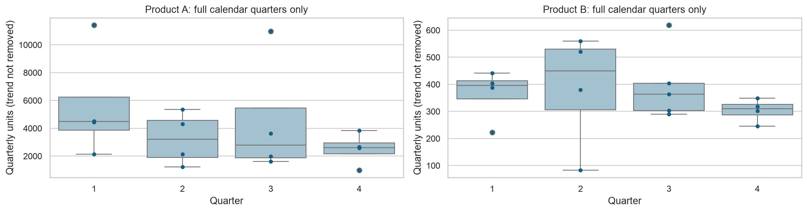
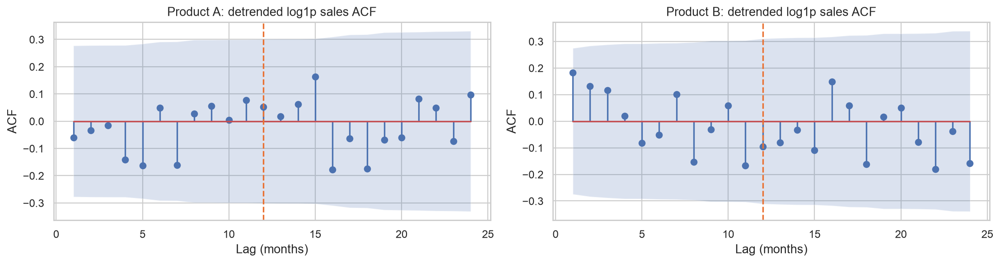
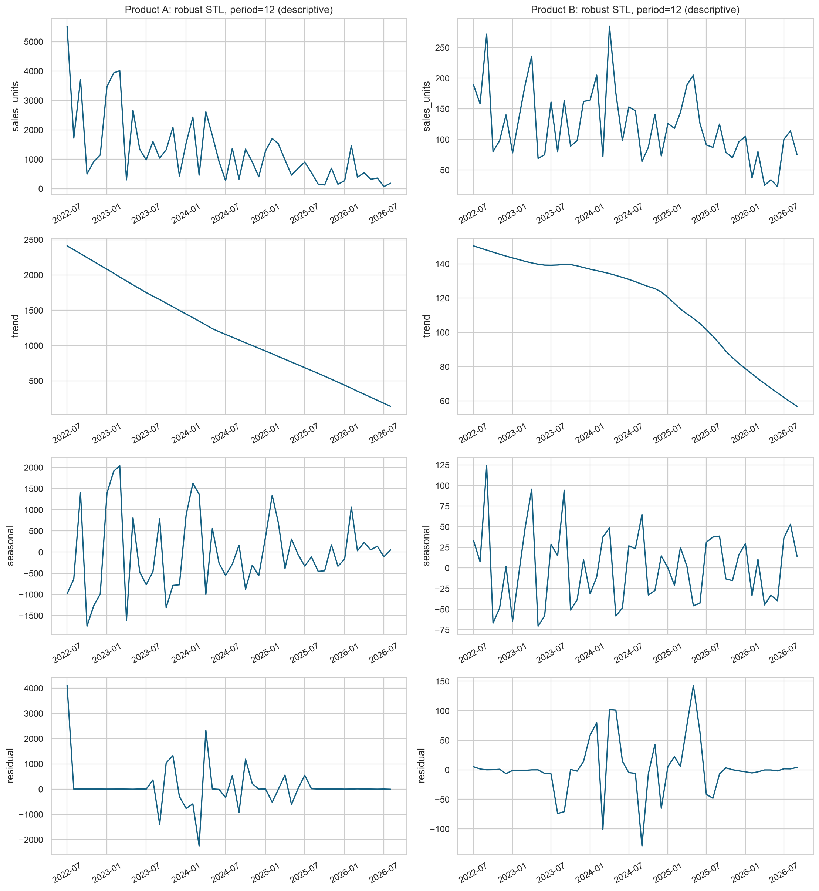

Quarterly profiles use only complete calendar quarters (`tables/quarter_seasonality_profile.csv`);
these raw profiles retain the long-term trend and are descriptive, not an additional seasonality test.

## 4–7. Variability, anomalies, availability, and product differences

Monthly ADI is total periods / positive-sale periods. CV² uses only positive periods (sample variance).
The conventional ADI=1.32 and CV²=0.49 shape thresholds are descriptive heuristics, not proof of a
particular stochastic process. Aggregation changes these labels: many zero-sales days do not imply
intermittent *monthly* sales. Neither classification resolves demand censored by unavailable stock.

| codigo_producto   | aggregation                |   adi |   cv2_positive_periods |   zero_periods | demand_class   |
|:------------------|:---------------------------|------:|-----------------------:|---------------:|:---------------|
| 48815-14050       | daily_interior_provisional | 4.720 |                  0.674 |           1224 | lumpy          |
| UAH-90385-18025   | daily_interior_provisional | 3.846 |                  2.686 |           1127 | lumpy          |

| codigo_producto   |   ending_recorded_balance |   minimum_recorded_balance |   maximum_recorded_balance |   negative_movement_balances |   zero_movement_balances |   eod_zero_days |   eod_negative_days |   eod_low_stock_days |   carried_forward_days |   non_sale_outgoing |
|:------------------|--------------------------:|---------------------------:|---------------------------:|-----------------------------:|-------------------------:|----------------:|--------------------:|---------------------:|-----------------------:|--------------------:|
| 48815-14050       |                        44 |                          0 |                       1244 |                            0 |                        5 |               8 |                   0 |                   65 |                   1250 |                 299 |
| UAH-90385-18025   |                      5567 |                       -206 |                      14802 |                            2 |                        5 |              17 |                   4 |                   17 |                   1137 |                5586 |

Zero movement balances and zero EOD days differ because replenishment can occur later on the same day.
Forward-filled balances assume no unrecorded movements, and negative days undermine physical-stock inference.
There are **indications of possible availability-related sales censoring**, not a measurable lost-sales total:
zero/low ledgers can coincide with unmet demand, but missing transaction times, backorders, and availability
logs prevent identification. Recorded sales may understate demand. Continued sales after small/negative
balances could also reflect timing or accounting problems, not confirmed stockout behavior.

| codigo_producto   |   months_nonpositive_eod |   mean_sales_exposed |   mean_sales_not_exposed |
|:------------------|-------------------------:|---------------------:|-------------------------:|
| 48815-14050       |                        1 |              118.000 |                  121.400 |
| UAH-90385-18025   |                        2 |             3625.000 |                 1181.000 |

Aligned recent inventory pressure (historical stock/sales ratios, not guaranteed future coverage):

| codigo_producto   | last_interior_month   |   aligned_closing_balance |   trailing_12_mean_sales |   bookkeeping_units_over_trailing12_monthly_sales |   trailing12_eod_nonpositive_days |   trailing12_eod_low_stock_days |
|:------------------|:----------------------|--------------------------:|-------------------------:|--------------------------------------------------:|----------------------------------:|--------------------------------:|
| 48815-14050       | 2026-09-01            |                    24.000 |                   69.833 |                                             0.344 |                                 0 |                               9 |
| UAH-90385-18025   | 2026-08-01            |                  5892.000 |                  393.250 |                                            14.983 |                                 0 |                               0 |

Product A's latest interior recorded stock is large relative to recent sales, while Product B's is small.
The recent Product A decline is **not explained by observed recent nonpositive EOD balances**; no such
days are recorded in its trailing 12 interior months. That does not rule out unrecorded availability
constraints, channel changes, or data omissions. Product B's near-depleted ledger merits prompt physical
stock and pending-order reconciliation, not an automatic claim of lost sales.

Anomalies retained, by category (one event can trigger several flags):

| codigo_producto   | type                           | classification                           |   flags |
|:------------------|:-------------------------------|:-----------------------------------------|--------:|
| 48815-14050       | document_or_repetition         | potential_data_quality_problem           |       8 |
| 48815-14050       | large_adjustment               | context_required                         |       2 |
| 48815-14050       | large_sale                     | legitimate_but_unusual_or_context_needed |       1 |
| UAH-90385-18025   | abrupt_monthly_change_combined | context_required                         |       3 |
| UAH-90385-18025   | abrupt_monthly_change_other    | context_required                         |       3 |
| UAH-90385-18025   | document_or_repetition         | potential_data_quality_problem           |       4 |
| UAH-90385-18025   | large_adjustment               | context_required                         |       3 |
| UAH-90385-18025   | large_sale                     | legitimate_but_unusual_or_context_needed |      49 |
| UAH-90385-18025   | negative_balance               | potential_data_or_timing_problem         |       2 |

Large wholesale orders can be legitimate and forecast-relevant. Adjustment outflows are not sales.
The missing document and repeated business keys are source-review candidates, not grounds for deletion.
Exploratory change-point searches use a max-split statistic on trend residuals, minimum 12 months per side,
and a circular moving-block bootstrap (block length 3; 1000 draws), then FDR:

| codigo_producto   | scenario   | candidate_change_month   |   max_split_statistic |   block_bootstrap_p |   before_mean_units |   after_mean_units | interpretation                                                  |   change_q_bh |
|:------------------|:-----------|:-------------------------|----------------------:|--------------------:|--------------------:|-------------------:|:----------------------------------------------------------------|--------------:|
| 48815-14050       | combined   | 2025-10-01               |                 1.822 |               0.455 |             137.179 |             69.833 | exploratory residual level shift, not a verified business event |         0.904 |
| UAH-90385-18025   | combined   | 2025-09-01               |                 1.263 |               0.634 |            1558.395 |            393.250 | exploratory residual level shift, not a verified business event |         0.904 |

Change dates are candidates for investigation only; no unverified causal business story is attached.
Different unit scales, transaction sizes, customer mixes, and inventory paths make product-specific models
more defensible than assuming the two products share one process. With only two SKUs, no pooled model is
claimed superior. Weekly/daily models are deferred: sparse events and uncertain stock availability add noise.

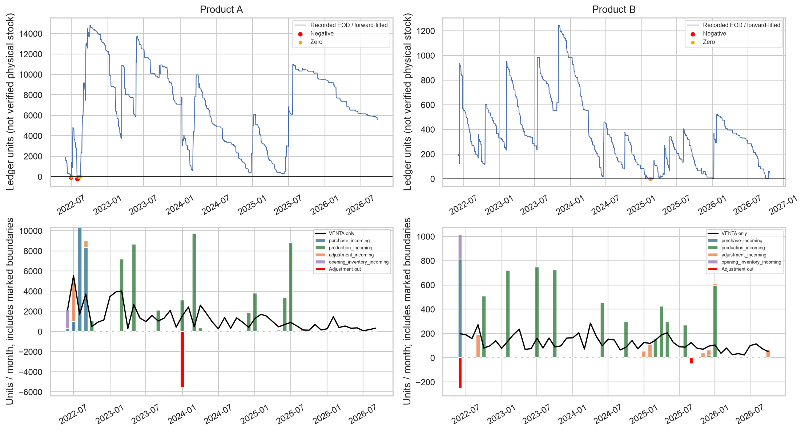
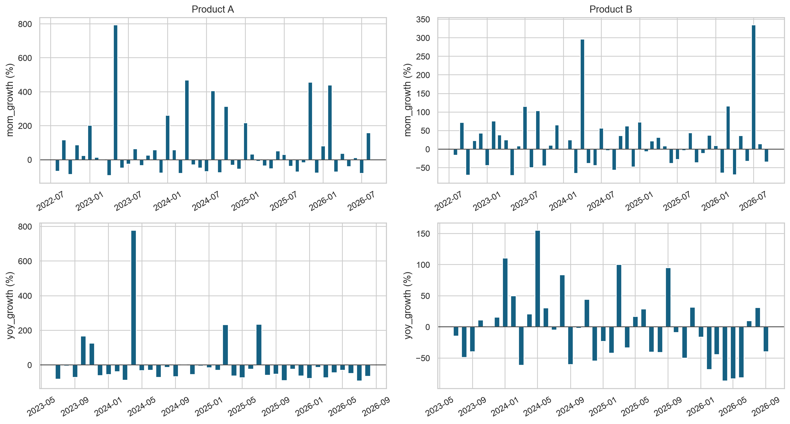

## 8–9. Forecasting and whether ML improves on baselines

Thirteen fixed candidates: historical mean; 3-/6-month means; naive; seasonal naive; linear regression;
ridge; ETS level, damped trend, additive seasonality; SARIMA(1,0,0)(1,0,0,12) with intercept;
shallow random forest; shallow gradient boosting. No parameter search or neural network is justified
by this sample. Regression uses seven predeclared predictors: lags 1/2/3, lagged 3-month mean, time index,
and month sine/cosine. Standardization is fitted inside each training fold. Other engineered features,
including lagged inventory, are exported but not included by default because the ledger is uncertain.

Each series starts with 24 months, then expands monthly. Earlier origins choose
the simplest model within 5% of best validation MAE. The most recent
6 complete months are evaluated **only after** selection. Candidates are fixed before
either stage; holdout rankings are diagnostics, not a second model-selection round. Holdout refits may use
earlier holdout actuals as they become available, representing one-step rolling deployment, not a six-step
forecast issued at one fixed origin. Failures are logged; incomplete-origin candidates cannot be selected.

| codigo_producto   | scenario   | model              | best_raw_mae_model   |   selected_validation_mae | validation_start   | validation_end   | holdout_start   | holdout_end   |   n_validation |   n_holdout |
|:------------------|:-----------|:-------------------|:---------------------|--------------------------:|:-------------------|:-----------------|:----------------|:--------------|---------------:|------------:|
| 48815-14050       | combined   | moving_average_3   | ets_damped           |                    34.952 | 2024-07-01         | 2026-03-01       | 2026-04-01      | 2026-09-01    |             21 |           6 |
| 48815-14050       | other      | naive              | moving_average_3     |                    37.714 | 2024-07-01         | 2026-03-01       | 2026-04-01      | 2026-09-01    |             21 |           6 |
| 48815-14050       | refama     | ets_seasonal_add   | ets_seasonal_add     |                    19.405 | 2024-07-01         | 2026-03-01       | 2026-04-01      | 2026-09-01    |             21 |           6 |
| UAH-90385-18025   | combined   | ridge              | linear_regression    |                   380.649 | 2024-07-01         | 2026-02-01       | 2026-03-01      | 2026-08-01    |             20 |           6 |
| UAH-90385-18025   | other      | ridge              | ridge                |                   370.309 | 2024-07-01         | 2026-02-01       | 2026-03-01      | 2026-08-01    |             20 |           6 |
| UAH-90385-18025   | refama     | historical_average | ridge                |                    60.206 | 2024-07-01         | 2026-02-01       | 2026-03-01      | 2026-08-01    |             20 |           6 |

Bias = forecast minus actual (positive means overforecast). WAPE and bias_pct are fractions; zero total
actuals give undefined WAPE, not zero. MASE uses each origin's training-only mean absolute lag-1 difference;
constant training histories have undefined scale. All forecasts are clipped to nonnegative units.

| codigo_producto   | phase      | model            |     mae |    rmse |   wape |    bias |   mase |   mae_skill_vs_naive |   mae_skill_vs_seasonal_naive |
|:------------------|:-----------|:-----------------|--------:|--------:|-------:|--------:|-------:|---------------------:|------------------------------:|
| UAH-90385-18025   | holdout    | naive            | 312.333 | 465.855 |  1.003 | 212.333 |  0.318 |                0.000 |                         0.422 |
| UAH-90385-18025   | holdout    | ridge            | 290.187 | 371.857 |  0.932 | 228.853 |  0.294 |                0.071 |                         0.463 |
| UAH-90385-18025   | holdout    | seasonal_naive   | 540.333 | 637.332 |  1.736 | 540.333 |  0.555 |               -0.730 |                         0.000 |
| UAH-90385-18025   | validation | naive            | 547.650 | 640.222 |  0.703 | -26.950 |  0.455 |                0.000 |                         0.140 |
| UAH-90385-18025   | validation | ridge            | 380.649 | 462.003 |  0.489 | 180.748 |  0.321 |                0.305 |                         0.402 |
| UAH-90385-18025   | validation | seasonal_naive   | 636.900 | 791.894 |  0.818 | 464.200 |  0.541 |               -0.163 |                         0.000 |
| 48815-14050       | holdout    | moving_average_3 |  37.333 |  45.134 |  0.604 |  -7.444 |  0.657 |               -0.093 |                         0.573 |
| 48815-14050       | holdout    | naive            |  34.167 |  42.570 |  0.553 |   0.833 |  0.603 |                0.000 |                         0.609 |
| 48815-14050       | holdout    | seasonal_naive   |  87.333 | 108.056 |  1.412 |  75.333 |  1.519 |               -1.556 |                         0.000 |
| 48815-14050       | validation | moving_average_3 |  34.952 |  41.255 |  0.313 |   8.127 |  0.525 |                0.076 |                         0.338 |
| 48815-14050       | validation | naive            |  37.810 |  44.829 |  0.339 |   0.857 |  0.568 |                0.000 |                         0.284 |
| 48815-14050       | validation | seasonal_naive   |  52.810 |  60.578 |  0.473 |  22.048 |  0.797 |               -0.397 |                         0.000 |

**Product A:** lowest ML validation MAE=371.27 (linear_regression); lowest simple-baseline MAE=492.46 (moving_average_6). The locked choice is **ridge**. Final holdout MAE=290.19 versus naive 312.33 (+7.1% MAE skill). A six-origin holdout and regime change do not establish a reliable deployment advantage.

**Product B:** lowest ML validation MAE=34.31 (random_forest); lowest simple-baseline MAE=34.95 (moving_average_3). The locked choice is **moving_average_3**. Final holdout MAE=37.33 versus naive 34.17 (-9.3% MAE skill). A six-origin holdout and regime change do not establish a reliable deployment advantage.

Paired MAE differences (positive means selected model improves), exploratory 95% moving-block bootstrap intervals:

| codigo_producto   | scenario   | phase      | selected_model   | baseline       |   paired_origins |   mean_mae_improvement |   improvement_ci_low |   improvement_ci_high |
|:------------------|:-----------|:-----------|:-----------------|:---------------|-----------------:|-----------------------:|---------------------:|----------------------:|
| 48815-14050       | combined   | validation | moving_average_3 | naive          |               21 |                  2.857 |               -9.163 |                14.401 |
| 48815-14050       | combined   | validation | moving_average_3 | seasonal_naive |               21 |                 17.857 |                4.077 |                31.447 |
| 48815-14050       | combined   | holdout    | moving_average_3 | naive          |                6 |                 -3.167 |              -18.556 |                12.222 |
| 48815-14050       | combined   | holdout    | moving_average_3 | seasonal_naive |                6 |                 50.000 |              -17.444 |               117.444 |
| UAH-90385-18025   | combined   | validation | ridge            | naive          |               20 |                167.001 |               46.683 |               298.392 |
| UAH-90385-18025   | combined   | validation | ridge            | seasonal_naive |               20 |                256.251 |               12.298 |               551.812 |
| UAH-90385-18025   | combined   | holdout    | ridge            | naive          |                6 |                 22.147 |             -109.351 |               153.644 |
| UAH-90385-18025   | combined   | holdout    | ridge            | seasonal_naive |                6 |                250.147 |               58.649 |               441.644 |

Small samples and selection bias limit these intervals; they are not proof of superior production performance.
All six series, all candidates, and both stages are in `tables/model_comparison.csv`; residual tests,
fit warnings, failed origins, and heuristic interval coverage are also exported.
`tables/performance_stability.csv` separates early/late halves of each evaluation stage without
using these diagnostics to reselect a winner. The numerically lowest holdout MAE methods are
{'48815-14050': 'naive', 'UAH-90385-18025': 'linear_regression'} (see comparison chart); these are
retrospective rankings, not replacements silently chosen after seeing the test outcomes.
Independent scenario forecasts may not sum to the combined forecast; their coherence gap is explicitly reported.

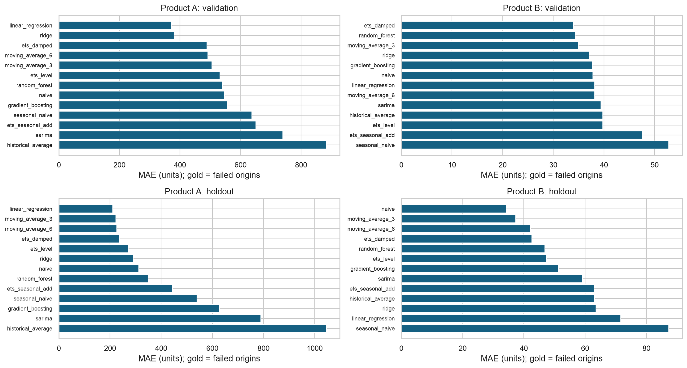
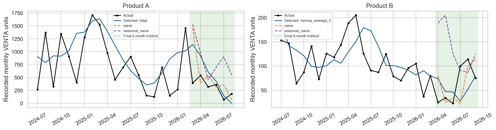
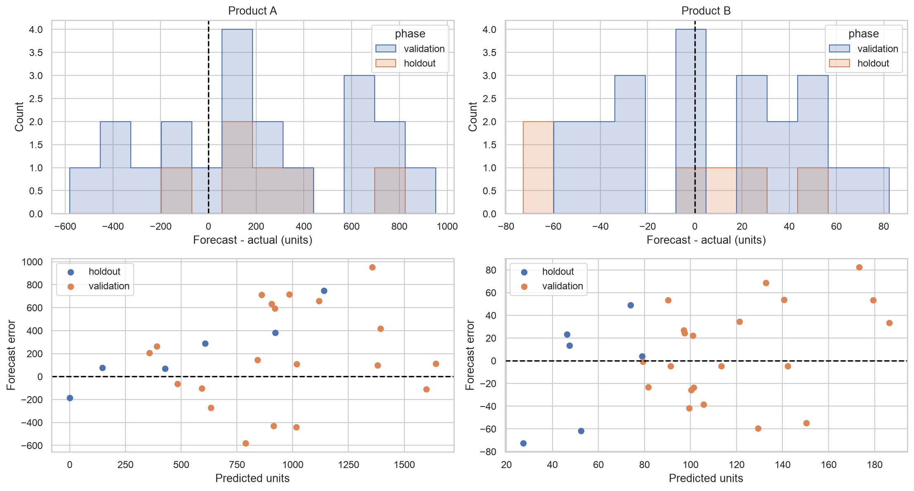

## Next-history-month forecasts, not live November 2026 forecasts

| codigo_producto   | scenario   | model              | forecast_origin   | target_month   |   forecast_units |   lower80_heuristic |   upper80_heuristic |   units_already_in_unconfirmed_boundary |
|:------------------|:-----------|:-------------------|:------------------|:---------------|-----------------:|--------------------:|--------------------:|----------------------------------------:|
| 48815-14050       | combined   | moving_average_3   | 2026-09-30        | 2026-10-01     |           96.333 |              41.667 |             151.000 |                                      51 |
| 48815-14050       | other      | naive              | 2026-09-30        | 2026-10-01     |           30.000 |               0.000 |             105.000 |                                      35 |
| 48815-14050       | refama     | ets_seasonal_add   | 2026-09-30        | 2026-10-01     |           36.250 |               6.583 |              65.917 |                                      16 |
| UAH-90385-18025   | combined   | ridge              | 2026-08-31        | 2026-09-01     |            0.000 |               0.000 |             658.274 |                                     325 |
| UAH-90385-18025   | other      | ridge              | 2026-08-31        | 2026-09-01     |            0.000 |               0.000 |             669.453 |                                     225 |
| UAH-90385-18025   | refama     | historical_average | 2026-08-31        | 2026-09-01     |           68.460 |               0.000 |             145.335 |                                     100 |

**Extrapolation failure warning:** the following raw predictions are negative and
clipped to zero. Positive recorded target-boundary sales directly contradict treating these point values
as zero demand. These are inadmissible-for-operations outputs, **not evidence of zero underlying demand**.

| codigo_producto   | scenario   | target_month   |   raw_forecast_units |   forecast_units |   units_already_in_unconfirmed_boundary |
|:------------------|:-----------|:---------------|---------------------:|-----------------:|----------------------------------------:|
| UAH-90385-18025   | combined   | 2026-09-01     |             -102.294 |            0.000 |                                     325 |
| UAH-90385-18025   | other      | 2026-09-01     |             -163.598 |            0.000 |                                     225 |

The locked choices and holdouts remain reported honestly; these observed failures are not hidden by
retuning on final outcomes. Raw predictions, clipping flags, and simple next-history-month reference
forecasts are exported for audit. Confirmed-new-month data and new prospective evaluation are required
before deployment.

Combined-sales simple reference forecasts (not newly selected or live forecasts):

| codigo_producto   | model              | target_month   |   forecast_units |
|:------------------|:-------------------|:---------------|-----------------:|
| 48815-14050       | naive              | 2026-10-01     |           75.000 |
| 48815-14050       | seasonal_naive     | 2026-10-01     |           79.000 |
| 48815-14050       | moving_average_3   | 2026-10-01     |           96.333 |
| 48815-14050       | moving_average_6   | 2026-10-01     |           61.833 |
| 48815-14050       | historical_average | 2026-10-01     |          121.333 |
| UAH-90385-18025   | naive              | 2026-09-01     |          184.000 |
| UAH-90385-18025   | seasonal_naive     | 2026-09-01     |          152.000 |
| UAH-90385-18025   | moving_average_3   | 2026-09-01     |          205.000 |
| UAH-90385-18025   | moving_average_6   | 2026-09-01     |          311.333 |
| UAH-90385-18025   | historical_average | 2026-09-01     |         1278.760 |

These are full-month predictions issued at the last defensibly usable historical origin. Actual partial
boundary sales are shown for context only, never used as future features or as full-month test outcomes.
The next real calendar month as of this analysis is **November 2026**; a validated one-step live forecast
is blocked by unconfirmed September/October coverage. No partial month was inflated, imputed as complete,
or silently skipped to pretend the model is current. Refresh and confirm coverage before live use.
The bands use finite-sample quantiles of the selected model's earlier validation absolute errors;
they are **heuristic**, selection-dependent, and not guaranteed calibrated under the observed demand change.

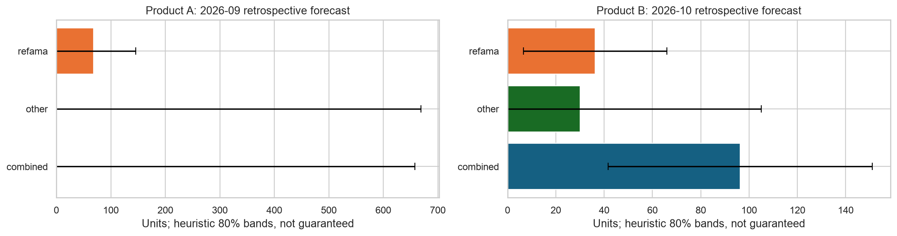

## 10. What can already be concluded about inventory?

- Preserve operation types and distinguish opening inventory from new supply.
- Audit negative balances, large adjustments, and depletion/replenishment sequences before treating
  bookkeeping availability as physical stock. Separate the Refama channel from other outgoing sales.
- Forecasting must adapt to changing recorded sales rather than extrapolate a global mean without validation.
- A reproducible policy interface can already calculate inventory position, reorder point, and order-up-to
  targets once missing inputs are supplied. The new manufacturing interface (section 13) adds production
  quantities, good-unit rates, available days, due-dated open orders, restrictions, batches and storage caps.

Retrospective **hypothetical** (s,S) examples use aligned recorded balances, forecast estimates,
lead times 0.5/1/2 months, service level 95%, review coverage 1 month, and assumed zero on-order/backorders.
Uncertainty is estimated from earlier validation errors; independent Gaussian monthly increments and
square-root-time scaling are unverified. This is not a validated achieved-service or optimal policy.
Product A's selected zero forecast has failed the above sanity check; its scenario arithmetic is retained
only as a preserved legacy purchasing-interface demonstration and must not drive production or purchasing.
It is not the new RUJAF production plan. All scenarios are blocked from live use.

| codigo_producto   | forecast_target_month   |   observed_bookkeeping_balance |   estimated_forecast_units |   assumed_lead_time_months |   reorder_point_units |   order_up_to_units |   suggested_order_units | status                |
|:------------------|:------------------------|-------------------------------:|---------------------------:|---------------------------:|----------------------:|--------------------:|------------------------:|:----------------------|
| 48815-14050       | 2026-10-01              |                         24.000 |                     96.333 |                      0.500 |                96.371 |             227.992 |                     204 | hypothetical_scenario |
| 48815-14050       | 2026-10-01              |                         24.000 |                     96.333 |                      1.000 |               164.505 |             289.075 |                     266 | hypothetical_scenario |
| 48815-14050       | 2026-10-01              |                         24.000 |                     96.333 |                      2.000 |               289.075 |             407.076 |                     384 | hypothetical_scenario |
| UAH-90385-18025   | 2026-09-01              |                       5892.000 |                      0.000 |                      0.500 |               507.367 |             878.786 |                       0 | hypothetical_scenario |
| UAH-90385-18025   | 2026-09-01              |                       5892.000 |                      0.000 |                      1.000 |               717.525 |            1014.734 |                       0 | hypothetical_scenario |
| UAH-90385-18025   | 2026-09-01              |                       5892.000 |                      0.000 |                      2.000 |              1014.734 |            1242.790 |                       0 | hypothetical_scenario |

Policy: inventory position = on hand + on order − backorders; ROP = forecast × lead + z × error_std × √lead;
S = forecast × (lead + review) + z × error_std × √(lead + review). If position ≤ ROP, order up to S,
rounded to packs and subject to optional MOQ/cap/budget constraints. Explicit safety stock may override
the Gaussian approximation. Monthly mean-rate arithmetic is a scenario approximation, not known intramonth timing.

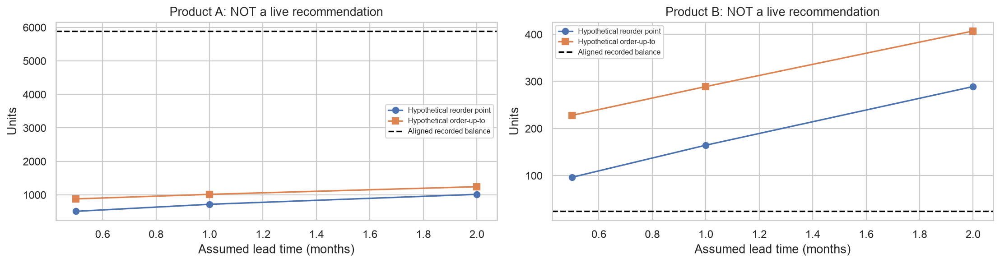

## 11. What cannot yet be concluded?

True retail/end-customer demand; exact lost sales; actual stockout duration; real supplier/production lead
times; optimal service levels; economically optimal reorder parameters; causal reasons for declining sales;
reliable long-range seasonality; expected deployment accuracy; achieved service or **actual financial savings**.
Falling recorded sales can combine market changes, customer ordering changes, supply constraints, or reporting
changes. The data cannot identify which explanation is correct.

The legacy purchasing financial interface still returns `blocked_missing_cost_inputs`. The manufacturing
interface separately returns `blocked_missing_manufacturing_cost_inputs`. Reported Q2.50/Q12.00 values
are unclassified and do not clear either gate. Synthetic tests verify arithmetic, not business savings.

## 12. Additional data and next steps (in priority order)

1. **Remaining provenance:** the RUJAF manufacturing / Refama retail relationship is confirmed. Still confirm
   stock ownership/location, transfer versus invoiced-sale definitions, SKU/unit-of-measure crosswalk,
   all branches/channels, and dispatch-to-Kardex reconciliation. Obtain qualified legal/accounting review
   of non-fiscal documents; do not assume their tax treatment is correct.
2. **Coverage confirmation:** PDF report start/end/as-of dates, full pages, all movements, corrected source
   records, current through-October ledgers, closure calendars, canceled/voided documents, and explanations
   for negative balances/large adjustments/encoding and missing-document flags.
3. **Unconstrained demand and availability:** transaction timestamps, physical stock checks, exact stockout
   start/end, backorders/unfilled inquiries/lost orders, substitutions, cancellations, returns linked to sales,
   customer/branch identifiers with consistent private normalization, and final Refama sell-through if retail
   demand is the desired target.
4. **Replenishment operations:** purchase/production order placement dates, promised dates, actual receipt
   dates **linked by order**, partial receipts, supplier/item-specific lead-time distributions, open pipeline,
   actual production days and calendars, sustainable/shared production capacity, materials/yield/setup times,
   minimum batches and packs. Reported 800/210 units per production day are operating-rate scenario inputs,
   not observed daily production or established capacity. Receipt dates alone cannot identify lead time.
5. **Policy and constraints:** current decision rules and order history, physical on-hand at a common cutoff,
   reserved stock/backorders, desired cycle-service or fill-rate definition, budget/storage constraints, and
   promotions/customer contracts or exceptional bulk orders known at forecast issuance.
6. **Costs and financial comparison:** first classify the reported net unit values; obtain dated actual
   manufacturing (including avoidable versus fixed components), purchase and landed costs in GTQ (or specified
   currency), storage/capital/insurance/obsolescence costs with time units, ordering/setup costs, defensible
   shortage/lost-margin costs, and terminal stock values. Compare policies on identical horizons, initial
   inventories/pipelines, service assumptions, and demand paths. Reduced production is not savings without
   accounting for unmet demand, eventual sales and ending inventory; timing/spend differences are not verified benefits.
7. After corrections, rerun the unchanged temporal split, audit segment/combined coherence, gather new months
   for genuine prospective evaluation, calibrate uncertainty, and only then test cost-aware policies against
   the documented current policy. Do not retune repeatedly on this final holdout and still call it untouched.

## 13. RUJAF business update: provisional manufacturing planning

### Three outgoing-demand streams and reported inputs

| codigo_producto   | scenario   | demand_stream                                                                |   all_observed_sales_units |   monthly_mean |   last_12_mean |   last_12_vs_first_12 |
|:------------------|:-----------|:-----------------------------------------------------------------------------|---------------------------:|---------------:|---------------:|----------------------:|
| 48815-14050       | combined   | Total recorded RUJAF outgoing sales (refama + other, once only)              |                       6437 |        121.333 |         69.833 |                -0.513 |
| 48815-14050       | other      | RUJAF recorded sales to other customers                                      |                       4042 |         75.078 |         29.167 |                -0.689 |
| 48815-14050       | refama     | RUJAF shipments to Refama (wholesale replenishment, not retail sell-through) |                       2395 |         46.255 |         40.667 |                -0.180 |
| UAH-90385-18025   | combined   | Total recorded RUJAF outgoing sales (refama + other, once only)              |                      66423 |       1278.760 |        393.250 |                -0.839 |
| UAH-90385-18025   | other      | RUJAF recorded sales to other customers                                      |                      62700 |       1210.300 |        331.500 |                -0.860 |
| UAH-90385-18025   | refama     | RUJAF shipments to Refama (wholesale replenishment, not retail sell-through) |                       3723 |         68.460 |         61.750 |                -0.153 |

- **Product A:** last-12 versus first-12 mean shipments change -15.3% to Refama, -86.0% to other customers, -83.9% overall.
- **Product B:** last-12 versus first-12 mean shipments change -18.0% to Refama, -68.9% to other customers, -51.3% overall.

The stronger other-customer decline warrants customer/order-mix investigation, not attribution of the
combined decline to Refama consumer consumption. Wholesale order batching and channel timing can change
independently of retail sell-through; these comparisons do not establish causes.

The same declining trajectories, uncertain seasonality, availability caveats and original validation-locked
results remain valid. Product A's Ridge extrapolation fails; B's locked moving average loses to naive on the
holdout. Neither fact justifies a hidden test-based model replacement or a claim of a robust ML advantage.

| codigo_producto   |   net_unit_value |   units_per_production_day | currency   | value_classification   | rate_status                                   |
|:------------------|-----------------:|---------------------------:|:-----------|:-----------------------|:----------------------------------------------|
| UAH-90385-18025   |            2.500 |                        800 | GTQ        | unconfirmed            | reported_operating_rate_NOT_verified_capacity |
| 48815-14050       |           12.000 |                        210 | GTQ        | unconfirmed            | reported_operating_rate_NOT_verified_capacity |

The values are reported, not cost/price/margin/profit. Rates are approximate **per production day**, not daily
production, maximum sustainable capacity, or proof of a feasible joint factory schedule.

### Explicit forecast safeguards and provisional fallback

`forecast_validity.py` rejects nonfinite/negative raw forecasts, clipping, fit failures, and implausible collapse
or spikes relative to the prior three-month mean. Default ratio limits 0.1–3.0 are configurable review heuristics,
not optimized business thresholds. Positive forecasts after three zero months also require review.
Only a failed check activates the fixed three-month moving-average fallback, which must pass the same checks.
A fallback failure blocks production calculations. No target-month actuals enter either decision.
Boundary actuals exceeding a forecast are shown separately as retrospective warnings, not fallback triggers.

| codigo_producto   | scenario   | locked_model       | locked_forecast_valid   | validity_reasons                                | effective_model   |   effective_forecast_units | fallback_used   | status                             |
|:------------------|:-----------|:-------------------|:------------------------|:------------------------------------------------|:------------------|---------------------------:|:----------------|:-----------------------------------|
| 48815-14050       | combined   | moving_average_3   | True                    |                                                 | moving_average_3  |                     96.333 | False           | locked_forecast_scenario_only      |
| 48815-14050       | other      | naive              | True                    |                                                 | naive             |                     30.000 | False           | locked_forecast_scenario_only      |
| 48815-14050       | refama     | ets_seasonal_add   | True                    |                                                 | ets_seasonal_add  |                     36.250 | False           | locked_forecast_scenario_only      |
| UAH-90385-18025   | combined   | ridge              | False                   | negative_raw_extrapolation;nonnegative_clipping | moving_average_3  |                    205.000 | True            | provisional_fallback_scenario_only |
| UAH-90385-18025   | other      | ridge              | False                   | negative_raw_extrapolation;nonnegative_clipping | moving_average_3  |                    191.667 | True            | provisional_fallback_scenario_only |
| UAH-90385-18025   | refama     | historical_average | False                   | spike_relative_to_recent_history                | moving_average_3  |                     13.333 | True            | provisional_fallback_scenario_only |

The original models, forecasts and historical metrics are unchanged. The new rule is replayed on the **same**
expanding one-step validation/holdout origins using the existing predictions and MAE/RMSE/WAPE/bias/MASE definitions:

| codigo_producto   | phase      | strategy                   |   origins |   successful_origins |   fallback_origins |     mae |    rmse |   wape |    bias |   mase |
|:------------------|:-----------|:---------------------------|----------:|---------------------:|-------------------:|--------:|--------:|-------:|--------:|-------:|
| 48815-14050       | holdout    | original_locked            |         6 |                    6 |                  0 |  37.333 |  45.134 |  0.604 |  -7.444 |  0.657 |
| 48815-14050       | holdout    | provisional_guarded_ma3_v1 |         6 |                    6 |                  0 |  37.333 |  45.134 |  0.604 |  -7.444 |  0.657 |
| 48815-14050       | holdout    | naive                      |         6 |                    6 |                  0 |  34.167 |  42.570 |  0.553 |   0.833 |  0.603 |
| 48815-14050       | holdout    | moving_average_3           |         6 |                    6 |                  0 |  37.333 |  45.134 |  0.604 |  -7.444 |  0.657 |
| 48815-14050       | validation | original_locked            |        21 |                   21 |                  0 |  34.952 |  41.255 |  0.313 |   8.127 |  0.525 |
| 48815-14050       | validation | provisional_guarded_ma3_v1 |        21 |                   21 |                  0 |  34.952 |  41.255 |  0.313 |   8.127 |  0.525 |
| 48815-14050       | validation | naive                      |        21 |                   21 |                  0 |  37.810 |  44.829 |  0.339 |   0.857 |  0.568 |
| 48815-14050       | validation | moving_average_3           |        21 |                   21 |                  0 |  34.952 |  41.255 |  0.313 |   8.127 |  0.525 |
| UAH-90385-18025   | holdout    | original_locked            |         6 |                    6 |                  0 | 290.187 | 371.857 |  0.932 | 228.853 |  0.294 |
| UAH-90385-18025   | holdout    | provisional_guarded_ma3_v1 |         6 |                    6 |                  1 | 270.575 | 365.196 |  0.869 | 270.575 |  0.273 |
| UAH-90385-18025   | holdout    | naive                      |         6 |                    6 |                  0 | 312.333 | 465.855 |  1.003 | 212.333 |  0.318 |
| UAH-90385-18025   | holdout    | moving_average_3           |         6 |                    6 |                  0 | 222.778 | 267.739 |  0.716 | 222.778 |  0.229 |
| UAH-90385-18025   | validation | original_locked            |        20 |                   20 |                  0 | 380.649 | 462.003 |  0.489 | 180.748 |  0.321 |
| UAH-90385-18025   | validation | provisional_guarded_ma3_v1 |        20 |                   20 |                  1 | 347.634 | 433.709 |  0.446 | 147.733 |  0.289 |
| UAH-90385-18025   | validation | naive                      |        20 |                   20 |                  0 | 547.650 | 640.222 |  0.703 | -26.950 |  0.455 |
| UAH-90385-18025   | validation | moving_average_3           |        20 |                   20 |                  0 | 505.117 | 616.458 |  0.649 |  65.250 |  0.421 |

- **Product A:** combined holdout diagnostic MAE 290.19 locked → 270.58 guarded; bias +228.85 → +270.58; 1 fallback origin(s).
- **Product B:** combined holdout diagnostic MAE 37.33 locked → 37.33 guarded; bias -7.44 → -7.44; 0 fallback origin(s).

The guard can worsen error (see the B/Refama stream in the full comparison CSV); it is not an accuracy optimizer.
In particular, a lower replay MAE can coexist with greater overforecast bias. B's locked total is not replaced
just because naive has lower holdout MAE.

This safeguard was designed after the original results were inspected. This is **post-hoc diagnostic replay,
not new independent test evidence**. It does not establish improved accuracy; prospective evaluation on new
complete months is required. Guarded validation residual dispersion and 80% error bands are heuristic,
selection-dependent and nonstationary. The fallback is a scenario reference, never a production deployment approval.

### Production-aware finished-goods scenarios

Configuration: `scenarios/rujaf_planning.json`; all parameters and the validity rules used are recorded in
`artifacts/rujaf_planning_readiness.json`. Each CSV row also records its exact production inputs as JSON.
Defaults explicitly assume 30 calendar days/month, 7 elapsed days to good-unit receipt, 30 review days,
1 or 5 production days **per SKU**, one-unit batches, zero or one forecast-month of safety stock, no open
orders/backlog/reservations/restrictions and no additional production/storage caps. These are not confirmed
business values. Weekly demand is monthly/30×7, not a validated weekly forecast.

| codigo_producto   | balance_cutoff   |   expected_monthly_outgoing_units |   coverage_days |   assumed_available_production_days |   safety_stock_units |   production_trigger_units |   surplus_above_target_units |   suggested_production_units |   estimated_production_days_required |   projected_shortage_units | status                           |
|:------------------|:-----------------|----------------------------------:|----------------:|------------------------------------:|---------------------:|---------------------------:|-----------------------------:|-----------------------------:|-------------------------------------:|---------------------------:|:---------------------------------|
| 48815-14050       | 2026-09-30       |                            96.333 |           7.474 |                                   1 |                0.000 |                    118.811 |                        0.000 |                           95 |                                0.452 |                          0 | hypothetical_production_scenario |
| 48815-14050       | 2026-09-30       |                            96.333 |           7.474 |                                   1 |               96.333 |                    215.144 |                        0.000 |                          192 |                                0.914 |                          0 | hypothetical_production_scenario |
| 48815-14050       | 2026-09-30       |                            96.333 |           7.474 |                                   5 |                0.000 |                    118.811 |                        0.000 |                           95 |                                0.452 |                          0 | hypothetical_production_scenario |
| 48815-14050       | 2026-09-30       |                            96.333 |           7.474 |                                   5 |               96.333 |                    215.144 |                        0.000 |                          192 |                                0.914 |                          0 | hypothetical_production_scenario |
| UAH-90385-18025   | 2026-08-31       |                           205.000 |         862.244 |                                   1 |                0.000 |                    252.833 |                     5639.167 |                            0 |                                0.000 |                          0 | hypothetical_production_scenario |
| UAH-90385-18025   | 2026-08-31       |                           205.000 |         862.244 |                                   1 |              205.000 |                    457.833 |                     5434.167 |                            0 |                                0.000 |                          0 | hypothetical_production_scenario |
| UAH-90385-18025   | 2026-08-31       |                           205.000 |         862.244 |                                   5 |                0.000 |                    252.833 |                     5639.167 |                            0 |                                0.000 |                          0 | hypothetical_production_scenario |
| UAH-90385-18025   | 2026-08-31       |                           205.000 |         862.244 |                                   5 |              205.000 |                    457.833 |                     5434.167 |                            0 |                                0.000 |                          0 | hypothetical_production_scenario |

Available stock = on hand − disjoint reservations − restrictions. Inventory position adds only open production
due by the planning horizon and subtracts non-overlapping backorders. Coverage excludes pipeline receipts.
The periodic-review trigger/target covers mean demand through **lead + review** plus explicit safety stock.
A separate lead-time alert uses only receipts due by lead time; later pipeline cannot hide early shortages.
Production is rounded to batches and capped by rate×allocated production days,
optional production limits and conservative storage headroom. Later orders cannot erase an immediate shortage;
overdue orders require reconciliation. Outputs also expose shortage before receipt, capacity-limited shortfalls,
and surplus above the target. Runtime = suggested units / scenario good-unit rate, **not** a verified schedule.
Daily rates do not establish materials availability, yield, setups, shared-line feasibility or achievable service.
Coverage is a constant-rate stock/forecast ratio, not a validated long-range demand horizon or guarantee.

These balances are aligned historical bookkeeping stocks, not current physical inventory. Live requests are
blocked, including for stale stock, failed forecasts and unconfirmed constraints; the prototype never grants live
approval. Historical scenarios require explicitly named unverified-stock, retrospective-forecast and constraint assumptions.
See [business assumptions](../docs/business_assumptions.md), [methods](../docs/methodology.md), and
[missing-data checklist](../docs/missing_data_checklist.md).

### Economic interface, with unclassified values kept separate

| codigo_producto   | balance_cutoff   |    units |   reported_net_unit_value |   scenario_net_unit_value |   unclassified_reference_amount | currency   | status                      |
|:------------------|:-----------------|---------:|--------------------------:|--------------------------:|--------------------------------:|:-----------|:----------------------------|
| 48815-14050       | 2026-09-30       |   24.000 |                    12.000 |                    12.000 |                         288.000 | GTQ        | unclassified_reference_only |
| UAH-90385-18025   | 2026-08-31       | 5892.000 |                     2.500 |                     2.500 |                       14730.000 | GTQ        | unclassified_reference_only |

These multiplications are **not inventory cost valuations, sales values or savings**. They refer to the aligned
historical stocks above, not current stock. Confirmed manufacturing cost inputs are still missing.
Scenario value overrides are recorded separately and never relabeled as new reported business values.
`ManufacturingCostInputs` and reconciled per-period production ledgers can evaluate manufacturing inventory
value, holding/setup/unmet-demand costs and alternative schedules. Caller-supplied unnecessary-production units
are accepted only as explicit hypothetical scenarios; unsold units are not automatically unnecessary production.
Schedule comparisons require identical demand paths, horizons and opening inventory, and include opening/ending
terminal valuation. Confirm opening pipeline, eventual sales and avoidable versus fixed costs before interpreting
any potential benefit. A production-spend reduction alone is never financial savings. RUJAF's dated current
decisions and real costs are absent, so no verified business savings or optimal production schedule is reported.
